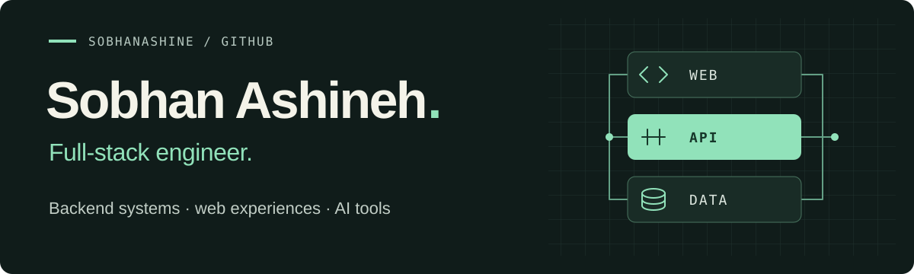

  

I'm a **full-stack engineer with a backend focus**, based in Rasht, Iran. I build web platforms, commerce experiences, operations dashboards, and AI/Telegram tools with **TypeScript, NestJS, and Next.js**.

My portfolio is **Future Media Services (FMS)**: the home for my project case studies, roles, technologies, and responsive product previews.

**[Portfolio — FMS ↗](https://futuremservices.ir/en/work)** &nbsp;·&nbsp; **[نمونه‌کارها ↗](https://futuremservices.ir/work)** &nbsp;·&nbsp; **[LinkedIn ↗](https://www.linkedin.com/in/sobhan-ashine-378336262/)**

## Selected work from FMS

| Project | My work, as documented in FMS |
| --- | --- |
| **[OFOQ](https://futuremservices.ir/en/work/ofoq)** | Headless architecture and frontend development; Persian, English, and Arabic content with Next.js and WordPress. |
| **[Aura Disposable](https://futuremservices.ir/en/work/aura-disposable)** | Web development lead; commerce and wholesale interfaces, Supabase, and product-code verification. |
| **[DigiMoragheb](https://futuremservices.ir/en/work/digimoragheb)** | Full-stack and real-time development; consultation and appointment workflows with WebSockets. |
| **[Ermetes](https://futuremservices.ir/en/work/ermetes)** | Website, user experience, operations dashboards, and service-calendar development. Case-study images show the review demo. |
| **[Simone Food](https://futuremservices.ir/en/work/simone-food)** | Website and catalog design and development for a Persian cookie brand. |
| **[Nafis Teb](https://futuremservices.ir/en/work/nafis-teb)** | Storefront design, development, and management infrastructure. FMS labels the case-study imagery as a design preview. |
| **[Karats Diamond](https://futuremservices.ir/en/work/karats-diamond)** | Storefront design, development, and product dashboard. The case study uses a demo catalog. |

Also in FMS: [Kashiland](https://futuremservices.ir/en/work/kashiland), [Paytakhte Ketab](https://futuremservices.ir/en/work/paytakhte-ketab), [Noornegar](https://futuremservices.ir/en/work/noornegar), and [Jaheshino](https://futuremservices.ir/en/work/jaheshino), listed as additional work. [Mehrshad Store](https://futuremservices.ir/en/work/mehrshad-store) is preserved in the archive.

## Public repositories

- **[Nazarato](https://github.com/sobhanashine/nazarato)** — A Persian review/discovery platform with approved-source business listings and moderated review workflows; currently at the early public-introduction stage.
- **[Future Media Services](https://github.com/sobhanashine/future-media-services)** — The bilingual portfolio and service website behind FMS, with project case studies, responsive previews, motion, and 3D.
- **[Research Agent](https://github.com/sobhanashine/research-agent)** — A Telegram assistant that asks clarifying questions, researches with Gemini, and delivers a Word report with source links.
- **[1ybet](https://github.com/sobhanashine/1ybet)** — A Persian World Cup score predictor for the web and Telegram, with shared accounts, rankings, and match notifications.

## Tools I work with

| Area | Stack |
| :--- | :--- |
| **Backend** | TypeScript, Node.js, NestJS, REST, GraphQL, WebSockets |
| **Frontend** | Next.js, React, Nuxt, Vue, Tailwind CSS |
| **Data** | PostgreSQL, Supabase, Redis, Prisma, Drizzle |
| **AI & integrations** | OpenAI, Gemini, Telegram Bot API |
| **Delivery & testing** | Cloudflare Workers, Docker, GitHub Actions, Vitest, Playwright |

---

For project discussions, [contact FMS](https://futuremservices.ir/en/contact) or [find me on LinkedIn](https://www.linkedin.com/in/sobhan-ashine-378336262/).
